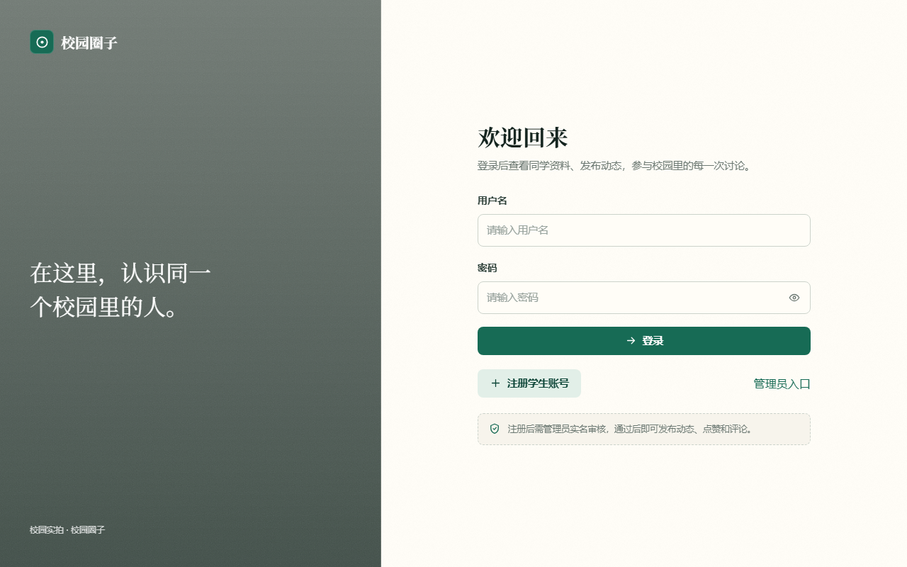
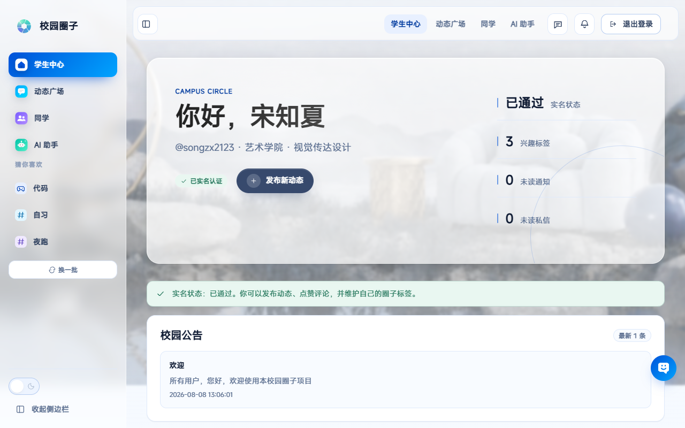
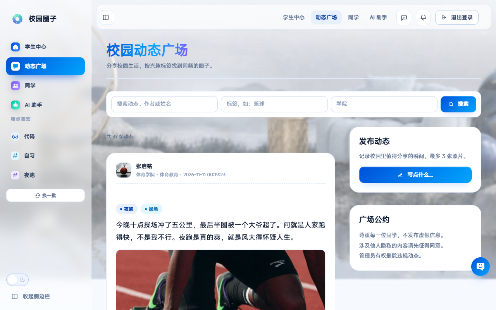
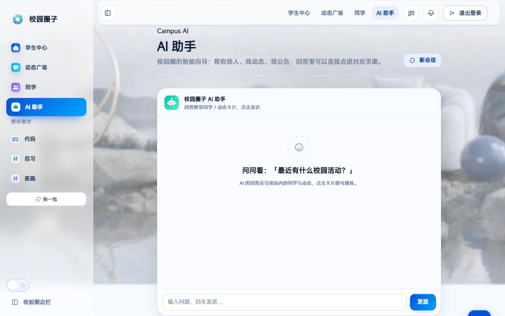
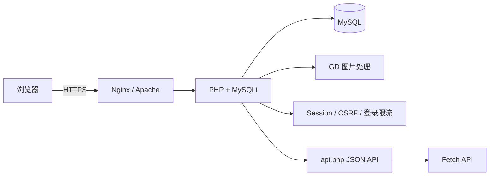

# 校园圈子 · Campus Circle

面向高校学生的实名社交平台。学生提交学生证完成实名审核后，可发布校园动态、检索同校同学、发起站内私信；管理端提供审核、举报处理、审计与运营数据能力。

线上地址：**https://www.lucky-campus.top**



## 1. 项目背景

高校场景中的社交需求集中在「同校、同专业、同兴趣」三层关系，通用社交平台无法验证学生身份，也难以按学院与年级组织内容。校园圈子以学生证实名审核为入口，将内容、关系与治理限定在可信范围内。

项目为独立开发，覆盖产品设计、前后端实现、数据库设计、部署与安全加固。

## 2. 目标用户与使用场景

| 角色 | 核心场景 |
| --- | --- |
| 在校学生 | 实名注册、浏览与发布动态、检索同学、私信沟通、接收通知 |
| 学生干部 / 社团负责人 | 发布活动信息、按话题组织内容 |
| 运营管理员 | 实名审核、内容审核、举报处理、公告发布、意见反馈处理 |
| 超级管理员 | 管理员账号管理、审计日志审阅与操作回滚、运营数据导出 |

## 3. 问题定义

| 问题 | 现状 | 目标 |
| --- | --- | --- |
| 身份不可信 | 通用平台无法验证学生身份 | 学生证上传 + 人工审核，关键资料变更触发重新审核 |
| 内容无治理 | 缺少举报与处置闭环 | 举报队列、三方删除、审计留痕与回滚 |
| 同学发现效率低 | 仅按姓名检索 | 按学院、年级、专业与兴趣标签双向检索与推荐 |
| 沟通渠道割裂 | 依赖第三方通讯工具 | 站内私信支持实时通知、图片、撤回与已读状态 |

## 4. 功能范围

### 4.1 账号与实名

- 注册需填写学号、学院、年级、专业并上传学生证，提交后进入待审核状态。
- 登录与注册采用算术验证码；登录支持邮箱验证码二步验证，验证通过的设备签发 30 天信任凭证。
- 密码找回支持短信或邮箱验证码，验证码限时、限次、限频。
- 关键资料变更自动触发重新审核。
- 存在运输中内容的账号不支持注销，注销前校验名下数据。

### 4.2 校园社区

- 动态发布支持最多 3 张图片、话题标签自动识别与草稿自动保存。
- 点赞与评论通过 JSON API 无刷新交互；评论支持回复、@ 展示与回复通知。
- 评论支持作者、动态发布者、管理员三方删除。
- 动态支持收藏与「我的收藏」集中回看。
- 动态广场支持关键词、话题、学院三重筛选与无限滚动加载。
- 发布前经敏感词过滤，命中内容直接拦截。

### 4.3 关系与沟通

- 关注与取关、关注者统计、关注通知。
- 同学页支持按姓名、学院、专业、兴趣标签双向检索，并按共同标签推荐。
- 站内私信：会话列表、未读分组、未读角标、2 分钟内撤回、表情面板、图片消息、本地草稿、已读状态、加载更早消息。
- 实时通知通过 SSE 推送，连接失败自动回退至轮询。
- 会话支持置顶与免打扰；隐私设置可限制仅关注者发起私信、关闭个人主页公开。
- 拉黑后无法关注、私信、点赞与评论互动。
- 通知支持分类筛选与按类型关闭。

### 4.4 AI 助手

- 自建对话页对接 Dify Agent，支持流式输出。
- 学生会话与管理员会话使用不同密钥与应用。
- 回答中引用的同学与动态自动转换为可点击卡片。

### 4.5 管理后台

- 总览：用户数、实名待审、动态、举报、活跃学生近 7 天看板。
- 实名审核：核对学生证后通过或驳回，操作写入审计。
- 内容治理：动态、评论、私信检索与删除，删除操作可在审计日志中一键恢复。
- 举报队列：学生举报动态或评论，管理员删除目标或忽略举报。
- 公告管理：发布校园公告，学生中心首页展示最新公告。
- 意见反馈：学生提交反馈（支持图片），管理员按状态处理并通知学生。
- 账号管理：超级管理员可创建运营管理员、调整角色、停用或启用账号。
- 审计与导出：审计日志分页、学生 CSV 导出、公告 / 举报 / 私信 / 动态 / 日报均支持 CSV 导出。
- 运营数据：按天统计注册、认证、内容、互动、举报与活跃学生，提供 30 天趋势。
- 管理员二次验证（TOTP），敏感入口按角色隐藏。

### 4.6 平台能力

- 动态、评论、私信均配置业务频控，保留用户名不可注册。
- 图片上传经真实性校验与重新编码，去除 EXIF 并限制尺寸。
- 提供健康检查接口，支持容器编排探活。
- 多尺寸缩略图，弱设备与省流量模式自动降级为静态背景。







## 5. 核心流程

**实名认证**：注册填写资料并上传学生证 → 进入待审核 → 管理员核对证件 → 通过后可发布内容 → 修改关键资料后重新审核。

**内容治理**：学生举报动态或评论 → 进入举报队列 → 管理员删除目标或忽略 → 操作写入审计 → 误删可回滚。

**私信**：发起会话 → SSE 建立实时通道（失败回退轮询）→ 发送文字、表情或图片 → 2 分钟内可撤回 → 已读状态回写 → 会话可置顶或免打扰。

## 6. 技术架构

| 类别 | 技术 |
| --- | --- |
| 后端 | PHP 7.3+ / 8.x，MySQLi 预处理语句 |
| 数据库 | MySQL 5.7+ / 8.0，20 个版本化迁移，28 张表 |
| 前端 | HTML + CSS + 原生 JavaScript（Fetch API），CSS 变量驱动的双主题设计系统 |
| AI 编排 | Dify Agent（streaming），站内自建对话页与代理层 |
| 测试 | PHPUnit 9、自研单元 / 集成测试、Playwright E2E |
| 工程化 | Composer、Docker Compose、GitHub Actions、PHPStan、PHP CS Fixer |



### 6.1 数据设计

28 张表按职责分为五组：

| 分组 | 表 |
| --- | --- |
| 账号与身份 | `user`、`student`、`login_attempt`、`login_otp`、`trusted_device`、`password_reset` |
| 内容 | `dynamic`、`dynamic_photo`、`dynamic_draft`、`dynamic_favorite`、`comment`、`like`、`sensitive_word` |
| 关系与沟通 | `follow`、`block`、`message`、`conversation_setting`、`privacy`、`notification`、`notification_pref` |
| 治理 | `audit_log`、`admin_rollback`、`report`、`action_log`、`announcement`、`feedback` |
| 平台 | `schema_migrations` |

### 6.2 API

统一入口 `api.php`，返回 JSON，POST 操作需 CSRF Token。

| 方法 | 地址 | 说明 |
| --- | --- | --- |
| GET | `api.php?action=unread` | 未读通知数 |
| GET | `api.php?action=health` | 健康检查（免登录） |
| POST | `api.php` | `action=like` 点赞 / 取消点赞 |
| POST | `api.php` | `action=comment` 发表评论 |
| POST | `api.php` | `action=deleteComment` 删除评论 |
| POST | `api.php` | `action=sendMessage` 发送私信（支持图片字段） |
| GET | `api.php` | `action=messages` 轮询新私信 |
| POST | `api.php` | `action=recallMessage` 撤回私信 |
| GET | `api.php` | `action=messagesBefore` 加载更早私信 |
| POST | `api.php` | `action=conversationSetting` 会话置顶 / 免打扰 |
| POST | `api.php` | `action=privacy` 更新隐私设置 |
| POST | `api.php` | `action=block` 拉黑 / 解除拉黑 |
| POST | `api.php` | `action=readNotifications` 全部标记已读 |

完整规范见 [OpenAPI 文档](docs/openapi.yaml)。

## 7. 安全设计

- 密码使用 bcrypt 哈希存储；所有 SQL 使用 MySQLi 预处理语句。
- 所有写操作校验 CSRF Token；输出统一 HTML 转义防 XSS。
- 登录、注册、找回密码均配置限流。
- Session 启用 strict mode、HttpOnly、SameSite，HTTPS 下启用 Secure。
- 上传图片通过 `getimagesize()` 校验，JPEG / PNG 重新编码去除 EXIF 并限制尺寸。
- 响应头包含 CSP、X-Frame-Options、X-Content-Type-Options、Referrer-Policy。
- 生产环境强制通过环境变量注入数据库密码与初始管理员密码。
- 管理员进入学生账号前必须勾选「已核实学生证」。

## 8. 质量验证

```bash
composer install
vendor/bin/phpunit
php tests/run.php
php tests/integration.php
php tests/security.php
vendor/bin/phpstan analyse --no-progress
vendor/bin/php-cs-fixer fix --dry-run --diff
```

集成测试环境变量：

```env
DB_HOST=127.0.0.1
DB_NAME=circle_test
DB_USER=root
DB_PASS=123456
APP_ENV=development
```

端到端测试：

```bash
npm install
npx playwright install chromium
npx playwright test
```

GitHub Actions 执行：PHP 语法检查、PHPUnit（含覆盖率）、PHPStan、PHP CS Fixer、轻量单元测试、MySQL 集成测试、迁移与种子数据验证、Docker Compose 配置校验、安全回归测试、Playwright 端到端测试。

## 9. 范围边界

- 面向单校区部署，未实现多租户隔离。
- AI 助手依赖 Dify 服务；未配置密钥时该入口不可用，不影响其他功能。
- 实时通知以 SSE 为主通道，轮询为回退方案，不保证强实时。
- 移动端已验证无横向溢出，未提供原生应用。

## 10. 部署与本地运行

### 10.1 本地环境

1. 复制 `.env.example` 为 `.env` 并配置数据库。
2. 执行 `php bin/migrate.php` 创建表结构。
3. 可选执行 `php bin/seed.php` 生成演示数据。
4. 将项目放入 Web 根目录，访问 `p_loginStu.php`。

管理员初始账号 `admin` / `Admin@123456`，首次登录后强制修改。演示学生账号密码统一为 `Demo@123456`。

### 10.2 Docker Compose

```bash
docker compose up -d --build
```

访问 `http://localhost:8080/p_loginStu.php`。首次访问自动执行迁移并创建管理员账号。

## 11. 目录结构

```text
campus/
├── bin/                       # 迁移、种子数据、过期数据清理
├── lib/                       # 核心库：auth / student / dynamic / notification / audit / report / upload / stats
├── docs/                      # 架构、API、设计系统、安全、部署、路线图、截图
├── config/                    # 敏感词配置
├── migrations/                # 20 个版本化迁移
├── assets/                    # CSS、JS、本地字体、背景视频
├── api.php                    # JSON API
├── ai_chat_api.php            # AI 助手代理（Dify Agent 流式）
├── p_*.php                    # 页面入口
├── tests/                     # 单元、集成、安全回归
├── Dockerfile
├── docker-compose.yml
└── .github/workflows/ci.yml
```

## 12. 相关文档

- [架构说明](docs/architecture.md)
- [API 文档](docs/api.md)
- [OpenAPI 规范](docs/openapi.yaml)
- [前端设计系统](docs/design-system.md)
- [生产部署指南](docs/deploy.md)
- [安全设计说明](docs/security.md)
- [项目路线图](docs/roadmap.md)
- [性能压测说明](benchmark/README.md)

## License

MIT
