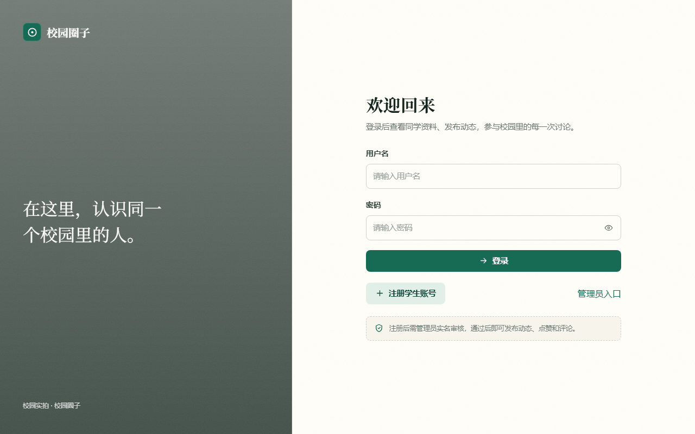
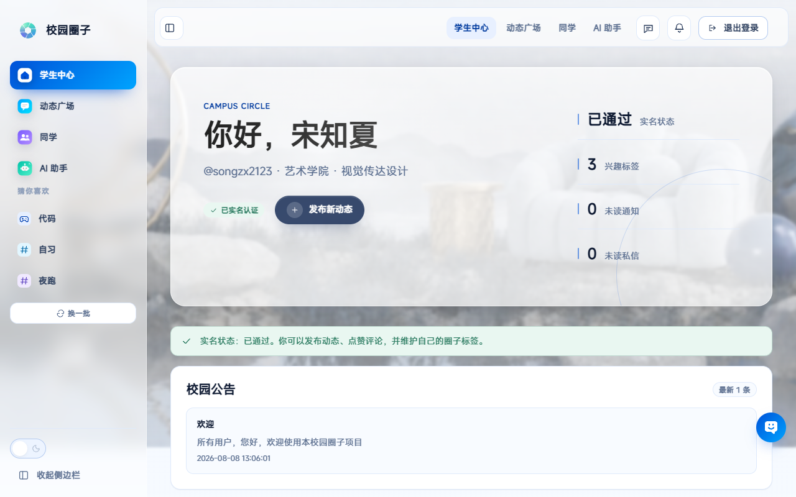
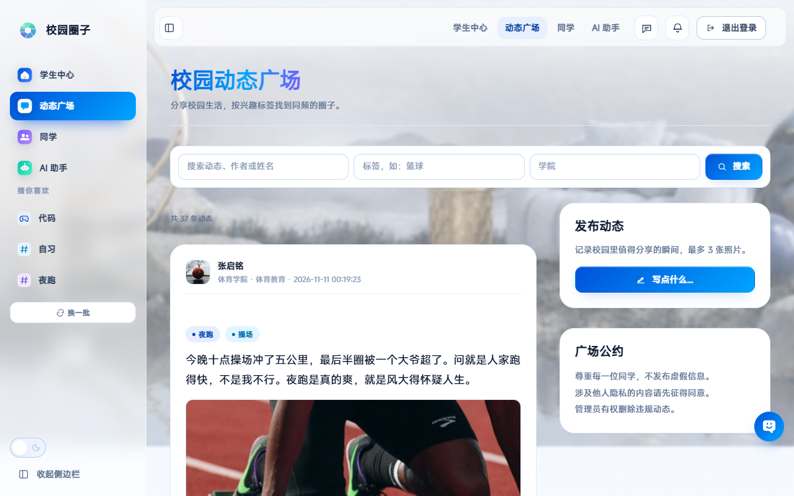
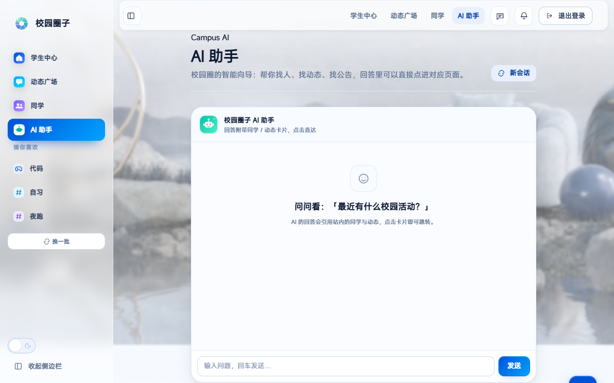
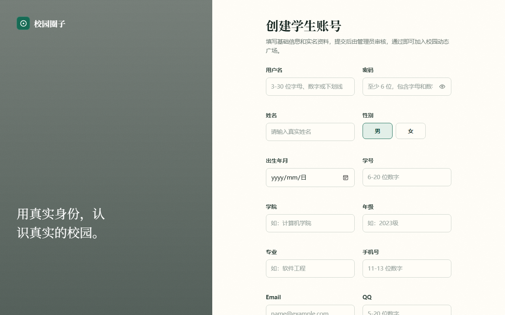
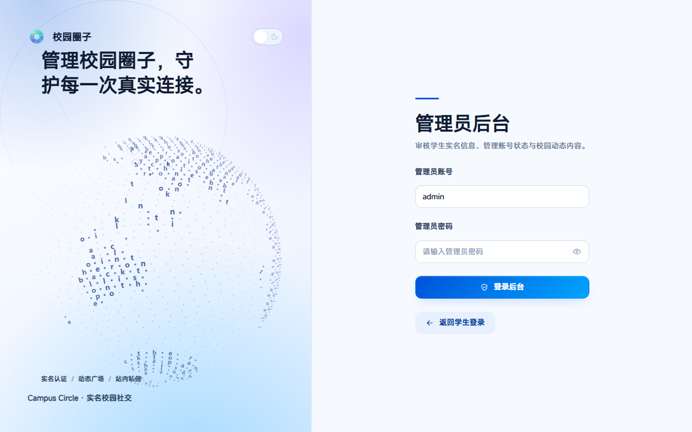
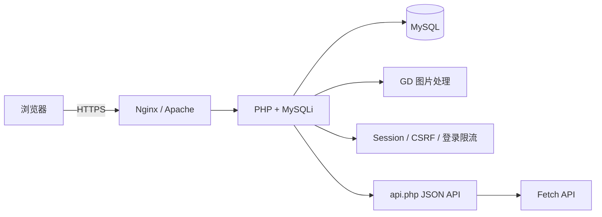
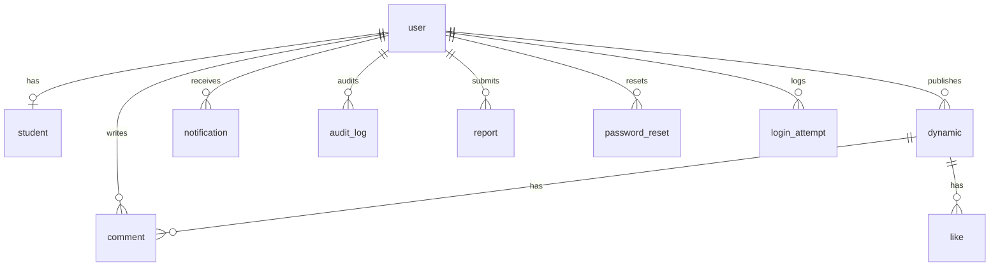

# 校园圈子 - Campus Circle

> 面向高校学生的实名社交平台，支持学生证实名审核、校园动态发布、点赞评论、站内通知、举报审核和密码找回。

---

## 页面预览













---

## 项目亮点

- 实名认证工作流：上传学生证，管理员核对证件后审核，关键资料变更自动重新审核
- 动态广场支持关键词、标签、学院搜索，无限滚动加载，点赞评论通过 JSON API 无刷新交互
- 评论支持评论作者、动态发布者、管理员三方删除
- 站内通知支持分类筛选与分页
- 举报审核队列：学生举报动态/评论，管理员删除目标或忽略举报
- 同学主页与同频推荐：按学院、年级、共同标签推荐可能认识的人
- 找回密码支持手机短信或邮箱验证码，验证码限时、限次、限频
- 关注系统：关注/取关、关注者统计、关注通知
- 通知偏好：可按类型关闭点赞、评论、审核、关注等通知
- 敏感词过滤：动态和评论发布前自动拦截违规内容
- 登录、注册、找回密码增加算术验证码
- 管理端近 7 天活跃看板、审计日志分页、学生 CSV 导出
- 站内私信：会话列表、未读角标、SSE 实时通知（失败自动回退轮询）、2 分钟内撤回、表情面板、图片消息、本地草稿、已读状态、加载更早消息
- 动态多图：发布最多 3 张图片，广场和主页展示图集
- 动态收藏：一键收藏/取消收藏，我的收藏页集中回看
- 话题标签：#话题 自动识别，点击即可按话题筛选动态
- 动态草稿：发布页自动保存，刷新后恢复，发布成功后自动清除
- 评论回复：支持回复某条评论，带“回复 @xxx”展示和回复通知
- 管理员权限分级：超级管理员/运营管理员，敏感后台入口按角色隐藏
- 管理员账号管理：超级管理员可创建运营管理员、调整角色、停用/启用账号
- 管理员操作回滚：动态、评论、私信删除可在审计日志一键恢复
- 拉黑用户：被拉黑后无法关注、私信、点赞、评论互动
- 会话置顶与免打扰：聊天可置顶会话、关闭新消息提醒
- 隐私设置：可限制仅自己关注的人发送私信，可关闭个人主页公开
- 业务频控：动态、评论、私信均有限流，保留用户名不可注册
- 校园公告：管理员发布公告，学生中心首页展示最新公告
- 私信审计：管理端可检索、删除私信并记录审计日志
- 管理端 CSV 导出：公告、举报、私信、动态、审计、日报均可导出
- 运营数据日报：按天统计注册、认证、内容、互动、举报与活跃学生
- 生产部署：Nginx/Apache 配置、生产 Docker Compose、健康检查、备份脚本
- 自动化安全回归测试
- Playwright E2E：登录、注册、发布动态、私信、管理员改密、移动端无溢出端到端测试
- 意见反馈闭环：学生提交反馈（支持图片附件），管理员按状态处理并通知学生
- 30 天运营趋势：注册、动态、评论、私信、活跃学生走势与 CSV 导出
- 移动端适配：手机视口无横向溢出，聊天、管理表格、趋势图均可横向滑动
- CampusLink 视觉体系：腾讯蓝 `#0052D9` 主色 + 配套深色主题、16px 大圆角卡片、悬停上浮微交互、侧栏「兴趣圈子」分组直达标签筛选，全站 lucide 风格线性图标
- 页面背景层：极光兜底 + 视频层 + 玻璃雾罩，卡片浮在雾罩之上；视频走本地资产（1920×1080 / 740KB），弱设备、移动端与省流量模式自动降级为静态背景
- 玻璃拟态组件：hero 卡、主区侧栏、统计卡与公告切角块分层使用不同模糊半径，控制合成开销
- 登录页文字地球：ThreeUI「Text Path Studies」的 2D canvas 移植，字符铺在陆地上随球自转，墨色取吉大校徽蓝 PANTONE 7455C
- 站点标志「光圈」：六片叶片收拢成开口，SVG 矢量一套源导出 favicon / apple-touch-icon / PWA 图标
- AI 助手：自建对话页对接 Dify Agent（流式），学生会话与管理员会话走不同密钥与应用，回答里的同学/动态自动转成可点击卡片
- 登录邮箱验证码二步验证：验证通过的设备签发 30 天信任凭证，同设备后续登录免验证码
- 私信列表按未读分组
- 管理员二次验证（TOTP）、SSE 实时通知、多尺寸缩略图、健康检查接口
- 登录/注册/找回密码限流、CSRF、bcrypt、图片真实性校验与重编码、安全响应头
- Docker Compose 一键启动，版本化 SQL 迁移，种子数据，GitHub Actions CI

---

## 技术栈

| 类别 | 技术 |
|------|------|
| 后端 | PHP 7.3+ / 8.x, MySQLi 预处理语句 |
| 数据库 | MySQL 5.7+ / 8.0（20 个版本化迁移，28 张表） |
| 前端 | HTML + CSS + 原生 JavaScript (Fetch API)，CSS 变量驱动的双主题设计系统 |
| AI 编排 | Dify Agent（streaming），站内自建对话页与代理层 |
| 测试 | PHPUnit 9 + 自研单元/集成测试 + Playwright E2E |
| 工程化 | Composer, Docker Compose, GitHub Actions, PHPStan, PHP CS Fixer |

## 架构



---

## 快速开始

### 方式一：PHPStudy / 本地环境

1. 复制 `.env.example` 为 `.env` 并配置数据库
2. 执行 `php bin/migrate.php` 创建表结构
3. 可选执行 `php bin/seed.php` 生成演示数据
4. 将项目放入 Web 根目录，访问 `p_loginStu.php`

管理员初始账号：`admin` / `Admin@123456`，首次登录后强制修改。

### 方式二：Docker Compose

```bash
docker compose up -d --build
```

访问 `http://localhost:8080/p_loginStu.php`。

首次访问会自动执行迁移并创建管理员账号。

### 演示数据

```bash
php bin/seed.php
```

演示学生账号密码统一为 `Demo@123456`。

---

## 项目结构

```text
campus/
├── bin/
│   ├── migrate.php             # 版本化迁移
│   ├── seed.php                # 演示数据
│   └── cleanup.php             # 清理过期记录
├── lib/
│   ├── bootstrap.php           # 安全 Session 与响应头
│   ├── core.php                # 数据库连接、CSRF、迁移入口
│   ├── migrations.php          # SQL 迁移执行器
│   ├── auth.php                # 登录、限流、密码找回
│   ├── student.php             # 学生注册、资料、推荐
│   ├── dynamic.php             # 动态、点赞、评论
│   ├── notification.php        # 站内通知
│   ├── audit.php               # 管理员审计
│   ├── report.php              # 举报审核
│   ├── upload.php              # 图片上传与重编码
│   ├── stats.php               # 后台统计
│   └── maintenance.php         # 过期数据清理
├── docs/
│   ├── architecture.md       # 架构说明
│   ├── api.md                # API 文档
│   ├── design-system.md      # 设计系统
│   ├── security.md           # 安全设计说明
│   ├── deploy.md             # 部署指南
│   ├── openapi.yaml          # OpenAPI 规范
│   ├── roadmap.md            # 项目路线图
│   └── screenshots/          # README 配图
├── config/
│   └── sensitive_words.php    # 敏感词配置
├── migrations/
│   └── 001_initial.sql ...    # 20 个版本化迁移（020_trusted_device.sql）
├── assets/
│   ├── css/                   # tokens/base/layout/components/pages/motion
│   ├── js/                    # app.js（主逻辑）+ auth-globe.js（文字地球）
│   ├── media/hero-flow.mp4    # 背景视频资产
│   └── fonts/                 # Manrope 自托管字体
├── api.php                     # JSON API
├── ai_chat_api.php             # AI 助手代理（Dify Agent 流式）
├── p_*.php                     # 页面入口
├── tests/
│   ├── Unit/                   # PHPUnit 单元测试
│   ├── run.php                 # 轻量单元测试
│   └── integration.php         # MySQL 集成测试
├── Dockerfile
├── docker-compose.yml
└── .github/workflows/ci.yml
```

---

## 数据库设计

| 表 | 说明 |
|----|------|
| `user` | 用户账号，包含角色与审核状态 |
| `student` | 学生实名资料、学生证照片、兴趣标签 |
| `dynamic` | 校园动态 |
| `dynamic_photo` | 动态图集（最多 3 张） |
| `dynamic_draft` | 动态草稿自动保存 |
| `dynamic_favorite` | 动态收藏 |
| `comment` | 动态评论 |
| `like` | 动态点赞 |
| `notification` | 站内通知 |
| `notification_pref` | 通知偏好 |
| `message` | 站内私信 |
| `conversation_setting` | 会话置顶与免打扰 |
| `privacy` | 隐私设置 |
| `follow` | 关注关系 |
| `block` | 拉黑关系 |
| `audit_log` | 管理员操作审计 |
| `admin_rollback` | 删除操作的回滚快照 |
| `action_log` | 关键动作日志 |
| `login_attempt` | 登录与注册限流 |
| `login_otp` | 登录邮箱验证码 |
| `trusted_device` | 受信任设备（30 天免验证码） |
| `password_reset` | 密码重置验证码 |
| `sensitive_word` | 敏感词库 |
| `report` | 举报审核队列 |
| `announcement` | 校园公告 |
| `feedback` | 意见反馈 |
| `schema_migrations` | 已执行迁移版本 |



---

## API

统一入口 `api.php`，返回 JSON，POST 操作需要 CSRF Token。

| 方法 | 地址 | 说明 |
|------|------|------|
| GET | `api.php?action=unread` | 获取未读通知数 |
| GET | `api.php?action=health` | 健康检查（无需登录） |
| POST | `api.php` | `action=like` 点赞/取消点赞 |
| POST | `api.php` | `action=comment` 发表评论 |
| POST | `api.php` | `action=deleteComment` 删除评论 |
| POST | `api.php` | `action=sendMessage` 发送私信（支持图片字段 `image`） |
| GET | `api.php` | `action=messages` 轮询新私信 |
| POST | `api.php` | `action=recallMessage` 撤回私信 |
| GET | `api.php` | `action=messagesBefore` 加载更早私信 |
| POST | `api.php` | `action=conversationSetting` 会话置顶/免打扰 |
| POST | `api.php` | `action=privacy` 更新隐私设置 |
| POST | `api.php` | `action=block` 拉黑/解除拉黑 |
| POST | `api.php` | `action=readNotifications` 全部标记已读 |

---

## 安全机制

- 密码使用 bcrypt 哈希存储
- 所有 SQL 使用 MySQLi 预处理语句
- 所有写操作校验 CSRF Token
- 登录、注册、找回密码均有限流
- Session 启用 strict mode、HttpOnly、SameSite，HTTPS 下启用 Secure
- 输出统一 HTML 转义防 XSS
- 上传图片通过 `getimagesize()` 校验，JPEG/PNG 重新编码去除 EXIF 并限制尺寸
- 响应头包含 CSP、X-Frame-Options、X-Content-Type-Options、Referrer-Policy
- 生产环境强制要求通过环境变量注入数据库密码与初始管理员密码
- 管理员通过学生账号前必须勾选“已核实学生证”

---

## 测试

```bash
composer install
vendor/bin/phpunit
php tests/run.php
php tests/integration.php
php tests/security.php
vendor/bin/phpstan analyse --no-progress
vendor/bin/php-cs-fixer fix --dry-run --diff
```

本地运行集成测试前设置：

```env
DB_HOST=127.0.0.1
DB_NAME=circle_test
DB_USER=root
DB_PASS=123456
APP_ENV=development
```

### E2E 测试

```bash
npm install
npx playwright install chromium
npx playwright test
```

GitHub Actions 会自动执行：

- PHP 语法检查
- PHPUnit 单元测试（含覆盖率）
- PHPStan 静态分析
- PHP CS Fixer 代码风格检查
- 轻量单元测试
- MySQL 集成测试
- 迁移与种子数据验证
- Docker Compose 配置校验
- 自动化安全回归测试
- Playwright 端到端测试

---

## 文档

- [架构说明](docs/architecture.md)
- [API 文档](docs/api.md)
- [OpenAPI 规范](docs/openapi.yaml)
- [前端设计系统](docs/design-system.md)
- [生产部署指南](docs/deploy.md)
- [安全设计说明](docs/security.md)
- [项目路线图](docs/roadmap.md)
- [性能压测说明](benchmark/README.md)

## License

MIT